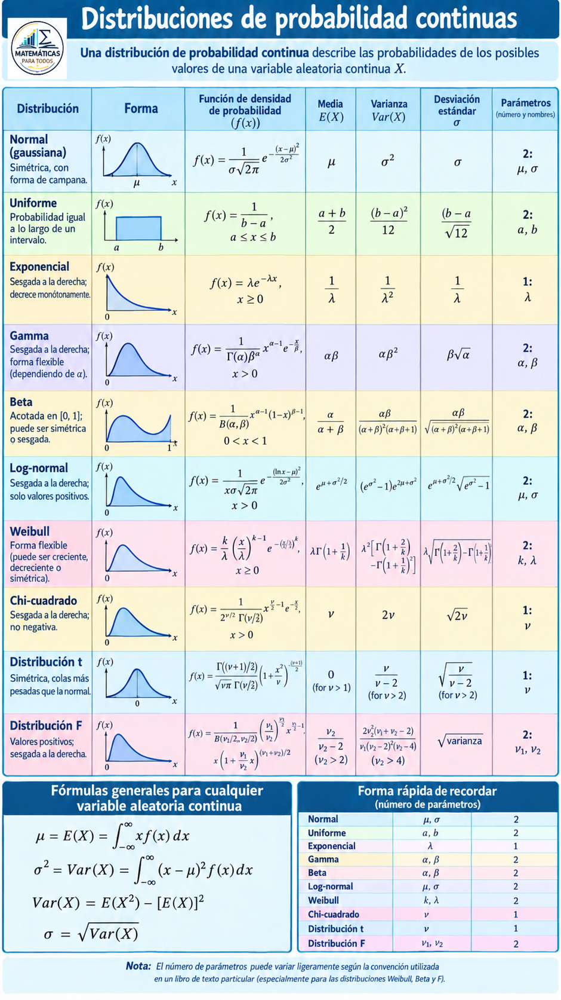

```{=html}
<div style="position:absolute; top:15px; right:10px;">

</div>
```

```{=html}
<div style="position:absolute; top:0px; left:10px;">

</div>
```

```{=html}
<style>
body{
  background-color:#f7f6ed;
  font-size:130%;
  text-align:justify;
}
</style>
```

# . PAQUETES

```{r}
# Verificar, instalar y activar el paquete "tidyverse"
if (!require(tidyverse)) {
  install.packages("tidyverse")
}
library(tidyverse)

# Verificar, instalar y activar el paquete "kableExtra"
if (!require(kableExtra)) {
  install.packages("kableExtra")
}
library(kableExtra)

# Verificar, instalar y activar el paquete "readxl"
if (!require(readxl)) {
  install.packages("readxl")
}
library(readxl)
library(gridExtra)
```

# . DISTRIBUCIÓN NORMAL

La distribución normal, también conocida como distribución gaussiana o campana de Gauss, es la distribución de probabilidad continua más importante en la estadística.

Su importancia radica en que muchos fenómenos naturales, sociales y económicos siguen este patrón.

La distribución normal es la distribución de probabilidad continua más usada en estadística y una herramienta fundamental para modelar una inmensa variedad de fenómenos en las ciencias, la ingeniería y la economía. Su popularidad se debe a una propiedad matemática conocida como el Teorema del Límite Central, que establece que la suma o el promedio de un gran número de variables aleatorias independientes (sin importar su distribución original) tiende a seguir una distribución normal.

**Características Clave**

La distribución normal es un tipo de distribución de probabilidad continua. Esto significa que la variable aleatoria puede tomar cualquier valor dentro de un rango determinado. Se representa por una curva simétrica en forma de campana, donde la mayor parte de los datos se agrupan alrededor del valor central.

**Forma de Campana:** La distribución es simétrica alrededor de su media, creando una curva con forma de campana. El punto más alto de la campana es la media.

**Media, Mediana y Moda Coincidentes:** En una distribución normal perfecta, estos tres valores son iguales y se encuentran en el centro de la curva.

**Asintótica al Eje Horizontal:** La curva se extiende indefinidamente en ambas direcciones, acercándose al eje x pero sin llegar a tocarlo.

**Regla Empírica:** Alrededor del 68% de los datos se encuentran dentro de una desviación estándar de la media **(μ±σ)**, el 95% dentro de dos desviaciones estándar **(μ±2σ)**, y el 99.7% dentro de tres desviaciones estándar **(μ±3σ)**.

**Parámetros**

La distribución normal está completamente definida por dos parámetros:

**Media *(μ)*:** Indica la ubicación del centro de la curva y el valor más probable.

**Varianza** σ2σ2 o Desviación Estándar (σ): Mide la dispersión o variabilidad de los datos. Una σ grande resulta en una curva más ancha y aplanada, mientras que una σ pequeña crea una curva más estrecha y alta.

**Fórmulas**

La fórmula principal de la distribución normal es la función de densidad de probabilidad (FDP). Esta función no calcula la probabilidad de un punto exacto, sino la densidad de probabilidad en ese punto.

Función de Densidad de Probabilidad (FDP):

$$f(x) = \frac{1}{\sigma \sqrt{2\pi}} e^{-\frac{1}{2} \left( \frac{x-\mu}{\sigma} \right)^2}$$ Donde:

***x*** es el valor de la variable aleatoria.

***μ*** es la media.

***σ*** es la desviación estándar.

***e*** es el número de Euler (aproximadamente 2.71828).

***π*** es la constante pi (aproximadamente 3.14159).

Para calcular probabilidades, se utiliza la distribución normal estándar, que tiene una media de 0 y una desviación estándar de 1. Cualquier variable normal puede estandarizarse usando la siguiente fórmula:

Fórmula de Estandarización (puntuación Z):

$$Z = \frac{x - \mu}{\sigma}$$

La puntuación Z nos dice cuántas desviaciones estándar está un valor dado de la media. Luego, se usan tablas o software estadístico para encontrar las probabilidades correspondientes.

## EJERCICIOS

**Ejercicio 1.1**

Un investigador científico informa que unos ratones vivirán un promedio de 40 meses cuando sus dietas se restringen drásticamente y después se enriquecen con vitaminas y proteínas. Suponiendo que la vidas de tales ratones se distribuyen normalmente con una desviación estándar de 6.3 meses, encuentre la probabilidad de que un ratón dado vivirá:

1.  más de 32 meses

2.  menos de 28 meses

3.  entre 37 y 49 meses

### Parametros

```{r}
media <- 40 
desviacion_estandar <- 6.3
```

### Solución de los puntos

::: panel-tabset
#### Punto 1

¿Cuál es probabilidad de que un ratón dado viva más de 32 meses?.

```{r}
prob_mas_de_32 <- 1 - pnorm(32, mean = media, sd = desviacion_estandar)
cat("a)", round(prob_mas_de_32, 4), "\n")
```

**Grafíca**

```{r}
media <- 40
desviacion_estandar <- 6.3
rango <- c(media - 3 * desviacion_estandar, media + 3 * desviacion_estandar)
ggplot(data.frame(x = rango), aes(x = x)) +  # Curva de la distribución normal
  stat_function(fun = dnorm, args = list(mean = media, sd = desviacion_estandar), 
                n = 500, color = "black") +  # Resaltar el área de interés (X > 32)
  geom_area(stat = "function", fun = dnorm, args = list(mean = media, sd = desviacion_estandar),
            fill = "#FF5785", xlim = c(32, rango[2]), alpha = 0.5) +  # Etiquetas y títulos
  labs(    title = "Distribucion Normal",    subtitle = "Probabilidad de vivir más de 32 meses",    x = "Vida en meses",    y = "Densidad de Probabilidad"  ) +  theme_bw() +  # Línea para el valor de 32
  geom_vline(xintercept = 32, linetype = "dashed", color = "#FF0000") +
  geom_text(aes(x = 32, y = 0.01, label = "32 meses"), hjust = -0.1, vjust = -1)
```

**RTA:** La probabilidad de que un ratón viva más de 32 meses es de 0.8979 (89.79%).

#### Punto 2

¿Cuál es la probabildad de que un ratón dado viva menos de 28 meses?.

```{r}
prob_menos_de_28 <- pnorm(28, mean = media, sd = desviacion_estandar)
cat("b)", round(prob_menos_de_28, 4), "\n")
```

**Grafíca**

```{r}
media <- 40
desviacion_estandar <- 6.3
rango <- c(media - 3 * desviacion_estandar, media + 3 * desviacion_estandar)
ggplot(data.frame(x = rango), aes(x = x)) +  # Curva de la distribución normal
  stat_function(fun = dnorm, args = list(mean = media, sd = desviacion_estandar), 
                n = 500, color = "black") +  # Resaltar el área de interés (X < 28)
  geom_area(stat = "function", fun = dnorm, args = list(mean = media, sd = desviacion_estandar),
            fill = "#FC6FD9", xlim = c(rango[1], 28), alpha = 0.5) +  # Etiquetas y títulos
  labs(    title = "Distribucion Normal",    subtitle = "Probabilidad de vivir menos de 28 meses",    x = "Vida en meses",    y = "Densidad de Probabilidad"  ) +  theme_bw() +  # Línea para el valor de 28
  geom_vline(xintercept = 28, linetype = "dashed", color = "#FF0000") +
  geom_text(aes(x = 28, y = 0.01, label = "28 meses"), hjust = 1.1, vjust = -1)
```

**RTA:** La probabilidad de que un ratón viva menos de 28 meses es de 0.0284 (2.84%)

#### Punto 3

¿Cuál es la probabilidad de que un ratón dado viva entre 37 y 49 meses?.

```{r}
prob_c_superior <- pnorm(49, mean = media, sd = desviacion_estandar)
prob_c_inferior <- pnorm(37, mean = media, sd = desviacion_estandar)
prob_c <- prob_c_superior - prob_c_inferior
cat("c)", round(prob_c, 4), "\n")
```

**Grafíca**

```{r}
media <- 40
desviacion_estandar <- 6.3
rango <- c(media - 3 * desviacion_estandar, media + 3 * desviacion_estandar)
ggplot(data.frame(x = rango), aes(x = x)) +  # Curva de la distribución normal
  stat_function(fun = dnorm, args = list(mean = media, sd = desviacion_estandar), 
                n = 500, color = "black") +  # Resaltar el área de interés (37 < X < 49)
  geom_area(stat = "function", fun = dnorm, args = list(mean = media, sd = desviacion_estandar),
            fill = "#6FFCFA", xlim = c(37, 49), alpha = 0.5) +  # Etiquetas y títulos
  labs(    title = "Distribucion Normal",    subtitle = "Probabilidad de vivir entre 37 y 49 meses",    x = "Vida en meses",    y = "Densidad de Probabilidad"  ) +  theme_bw() +  # Líneas para los valores de 37 y 49
  geom_vline(xintercept = 37, linetype = "dashed", color = "#FF0000") +
  geom_vline(xintercept = 49, linetype = "dashed", color = "#FF0000") +
  geom_text(aes(x = 37, y = 0.01, label = "37"), hjust = 1.1, vjust = -1) +
  geom_text(aes(x = 49, y = 0.01, label = "49"), hjust = -0.1, vjust = -1)
```

**RTA:** La probabilidad de que un ratón viva entre 37 y 49 meses es de 0.6065 (60.65%)
:::

**Ejercicio 1.2**

Una máquina expendedora de bebidas gaseosas se regula para que sirva un promedio de 200 mililitros por vaso. Si la cantidad de bebida se distribuye normalmente con una desviación estándar igual a 15 mililitros,

1.  ¿qué fracción de los vasos contendrá más de 224 mililitros?

2.  ¿cuál es la probabilidad de que un vaso contenga entre 191 y 209 mililitros?

3.  ¿cuántos vasos probablemente se derramarán si se utilizan vasos de 230 mililitros para las siguientes 1000 bebidas?

### Parametros

```{r}
media <- 200
desviacion_estandar <- 15
```

### Solucion de los puntos

::: panel-tabset
#### Punto 1

¿ Qué fracción de los vasos contendrá más de 224 ML?

```{r}
prob_a <- 1 - pnorm(224, mean = media, sd = desviacion_estandar)
cat("a)", round(prob_a, 4), "\n")
```

**Grrafíca**

```{r}
rango <- c(media - 3 * desviacion_estandar, media + 3 * desviacion_estandar)
ggplot(data.frame(x = rango), aes(x = x)) +
  stat_function(fun = dnorm, args = list(mean = media, sd = desviacion_estandar)) +
  geom_area(stat = "function", fun = dnorm, args = list(mean = media, sd = desviacion_estandar),
            fill = "#84FC6F", xlim = c(224, max(rango)), alpha = 0.6) +
  labs(    title = "Probabilidad de que un vaso contenga más de 224 ml",    x = "Cantidad de bebida (ml)",    y = "Densidad de probabilidad"  ) +
  geom_vline(xintercept = 224, linetype = "dashed", color = "#FF0000") +  theme_minimal()
```

**RTA:** La probabilidad de que una fracción de vasos contengá mas de 224 ML es 0.0548 (54.8%)

#### Punto 2

¿ Cuál es la probabilidad de que un vaso contenga entre 191 y 209 ML?

```{r}
media <- 200
desviacion_estandar <- 15
prob_b_superior <- pnorm(209, mean = media, sd = desviacion_estandar)
prob_b_inferior <- pnorm(191, mean = media, sd = desviacion_estandar)
prob_b <- prob_b_superior - prob_b_inferior
cat("b)", round(prob_b, 4), "\n")
```

**Grafíca**

```{r}
rango <- c(media - 3 * desviacion_estandar, media + 3 * desviacion_estandar)
ggplot(data.frame(x = rango), aes(x = x)) +
  stat_function(fun = dnorm, args = list(mean = media, sd = desviacion_estandar)) +
  geom_area(stat = "function", fun = dnorm, args = list(mean = media, sd = desviacion_estandar),
            fill = "#FF7575", xlim = c(191, 209), alpha = 0.6) +
  labs(    title = "Probabilidad de un vaso entre 191 ml y 209 ml",    x = "Cantidad de bebida (ml)",    y = "Densidad de probabilidad"  ) +
  geom_vline(xintercept = 191, linetype = "dashed", color = "#FF0000") +
  geom_vline(xintercept = 209, linetype = "dashed", color = "#FF0000") +
  theme_minimal()
```

**RTA:** La probabilidad de que un vaso contenga entre 191 y 209 ML es de 0.4515 (45.15%)

#### Punto 3

¿Cuántos vasos probablemente se derramarán si se utiliza vasos de 230 ML para las siguientes 1.000 bebidas?

```{r}
media <- 200
desviacion_estandar <- 15
total_vasos <- 1000
prob_derramarse <- 1 - pnorm(230, mean = media, sd = desviacion_estandar)
vasos_derramados <- prob_derramarse * total_vasos
cat("c)", round(vasos_derramados), "vasos\n")
```

**Grafíca**

```{r}
rango <- c(media - 3 * desviacion_estandar, media + 3 * desviacion_estandar)
ggplot(data.frame(x = rango), aes(x = x)) +
  stat_function(fun = dnorm, args = list(mean = media, sd = desviacion_estandar)) +
  geom_area(stat = "function", fun = dnorm, args = list(mean = media, sd = desviacion_estandar),
            fill = "#7593FF", xlim = c(230, max(rango)), alpha = 0.6) +
  labs(    title = "Probabilidad de que un vaso se derrame",    x = "Cantidad de bebida (ml)",    y = "Densidad de probabilidad"  ) +
  geom_vline(xintercept = 230, linetype = "dashed", color = "#FF0000") +
  theme_minimal()
```

**RTA:** Si se utiliza vasos de 230 ML para las siguientes 1.000 bebidas probablemente se derramarán 23 vasos
:::

**Ejercicio 1.3** Un abogado viaja todos los días de su casa en los suburbios a su ofi cina en el centro de la ciudad. El tiempo promedio para un viaje sólo de ida es 24 minutos, con una desviación estándar de 3.8 minutos. Suponga que la distribución de los tiempos de viaje está distribuida normalmente.

1.  ¿Cuál es la probabilidad de que un viaje tome al menos 1/2 hora?

2.  Si la oficina abre a las 9:00 A.M. y él sale diario de su casa a las 8:45 A.M., ¿qué porcentaje de las veces llegará tarde al trabajo?

3.  Encuentre la longitud de tiempo por arriba de la cual encontramos e1 15% de los viajes más lentos.

4.  Encuentre la probabilidad de que 2 de los siguientes 3 viajes tomen al menos 1/2 hora.

### Parametros

```{r}
media <- 24
desviacion <- 3.8
```

### Solución de puntos

::: panel-tabset
#### Punto 1

¿Cuál es la probabilidad de que un viaje tome al menos 1/2 hora?

```{r}
media <- 24
desviacion <- 3.8
prob_a <- 1 - pnorm(30, mean = media, sd = desviacion)
cat("a)", round(prob_a, 4), "\n")
```

**Grafíca**

```{r}
rango <- c(media - 3 * desviacion, media + 3 * desviacion)
ggplot(data.frame(x = rango), aes(x = x)) +
  stat_function(fun = dnorm, args = list(mean = media, sd = desviacion), n = 500) +
  geom_area(stat = "function", fun = dnorm, args = list(mean = media, sd = desviacion), fill = "#75E1FF", xlim = c(30, max(rango)), alpha = 0.6) +
  labs(title = "Distribucion Normal", x = "Tiempo de viaje (minutos)", y = "Densidad de Probabilidad") +
  geom_vline(xintercept = 30, linetype = "dashed", color = "#FF0000") +
  theme_minimal()
```

**RTA:** La probabilidad de que un viaje tome al menos 1/2 hora es de 0.0572 (5.72%)

#### Punto 2

Si la oficina abre a las 9:00 A.M. y él sale diario de su casa a las 8:45 A.M.

¿Qué porcentaje de las veces llegará tarde al trabajo?

```{r}
prob_b <- 1 - pnorm(15, mean = media, sd = desviacion)
porcentaje_b <- prob_b * 100
cat("b)", round(porcentaje_b, 2), "%\n")
```

**Grafíca**

```{r}
rango <- c(media - 3 * desviacion, media + 3 * desviacion)
ggplot(data.frame(x = rango), aes(x = x)) +
  stat_function(fun = dnorm, args = list(mean = media, sd = desviacion), n = 500) +
  geom_area(stat = "function", fun = dnorm, args = list(mean = media, sd = desviacion),fill = "#BB96FF", xlim = c(15, max(rango)), alpha = 0.6) +
  labs(title = "Distribucion Normal", x = "Tiempo de viaje (minutos)", y = "Densidad de Probabilidad") +
  geom_vline(xintercept = 15, linetype = "dashed", color = "#FF0000") +  theme_minimal()
```

**RTA:** Si la oficina abre a las 9:00 A.M y él sale diario de su casa a las 8:45 A.M, entonces llegará 99.11% tarde al trabajo.

#### Punto 3

Encuentre la longitud de tiempo por arriba de la cual encontramos e1 15% de los viajes más lentos.

```{r}
valor_d <- qnorm(0.85, mean = media, sd = desviacion)
cat("d)", round(valor_d, 2), "minutos\n")
```

**Grafíca**

```{r}
media <- 24
desviacion <- 3.8
valor_cuantil <- qnorm(0.85, mean = media, sd = desviacion)
rango <- c(media - 3 * desviacion, media + 3 * desviacion)
library(ggplot2)
ggplot(data.frame(x = rango), aes(x = x)) +
  stat_function(fun = dnorm, args = list(mean = media, sd = desviacion), n = 500) +
  geom_area(stat = "function", fun = dnorm, args = list(mean = media, sd = desviacion), fill = "#FFBA57", xlim = c(valor_cuantil, max(rango)), alpha = 0.6) +
  labs(    title = "Distribucion Normal", subtitle = "Viajes más lentos (15% superior)",    x = "Tiempo de viaje (minutos)",    y = "Densidad de Probabilidad"  ) +
  geom_vline(xintercept = valor_cuantil, linetype = "dashed", color = "#FF0000") +
  geom_text(aes(x = valor_cuantil, y = dnorm(valor_cuantil, mean = media, sd = desviacion), label = paste0(round(valor_cuantil, 2), " min")), vjust = -1, hjust = -0.1) +
  theme_minimal()
```

**RTA:** LA longitud de tiempo por arriba lo cual encontramos el 15% de los viajes más lentos es de 27.94 minutos

#### Punto 4

Encuentre la probabilidad de que 2 de los siguientes 3 viajes tomen al menos 1/2 hora.

```{r}
p_exito <- 1 - pnorm(30, mean = media, sd = desviacion)
n_viajes <- 3
x_exitos <- 2
prob_e <- dbinom(x_exitos, size = n_viajes, prob = p_exito)
cat("e)", round(prob_e, 4), "\n")
```

**Grafíca**

```{r}
p_exito <- 1 - pnorm(30, mean = 24, sd = 3.8) 
n_viajes <- 3 
exitos_deseados <- 0:n_viajes
probabilidades <- dbinom(exitos_deseados, size = n_viajes, prob = p_exito)
df_binomial <- data.frame( num_exitos = factor(exitos_deseados),  prob = probabilidades)
library(ggplot2)
ggplot(df_binomial, aes(x = num_exitos, y = prob)) +
  geom_bar(stat = "identity", fill = "#7DC2FF") +
  geom_text(aes(label = round(prob, 4)), vjust = -0.5) +
  labs(    title = "Distribución Binomial de viajes que tardan ≥ 30 minutos",   subtitle = "La probabilidad de tener exactamente 2 'éxitos' es del 0.94%", x = "Número de viajes de al menos 30 minutos",   y = "Probabilidad"  ) +
  theme_minimal()
```

**RTA:** La probabilidad de que 2 de los 3 viajes tomen al menos 1/2 hora es de 0.0092 (0.92%).
:::

# . DISTRIBUCIÓN CHI CUADRADO

La distribución chi-cuadrado $x^2$ es una distribución de probabilidad continua definida solo para valores positivos, que surge de la suma de los cuadrados de variables normales estándar independientes, dependiendo de un parámetro llamado grados de libertad **(𝑘)**. Su media es **𝑘**, su varianza **2𝑘** y su forma varía según **𝑘**: es muy asimétrica para valores pequeños y se aproxima a una normal al crecer. Su función de densidad se expresa mediante la función gamma, y es fundamental en estadística porque se utiliza en pruebas de hipótesis (bondad de ajuste e independencia en tablas de contingencia), en la construcción de intervalos de confianza para varianzas y en la base de otras distribuciones como la **t de Student y la F de Fisher**. En términos intuitivos, mide la dispersión total al sumar cuadrados de desviaciones de normales, por lo que resulta clave para analizar varianzas y asociaciones entre variables.

**Parámetros y Características**

A diferencia de la distribución normal, la distribución chi cuadrado no está definida por una media y una desviación estándar, sino por un único parámetro:

**Grados de libertad (v o df):** Este parámetro determina la forma de la distribución. A medida que los grados de libertad aumentan, la forma de la distribución se vuelve más simétrica y se aproxima a una distribución normal.

**Valores No Negativos:** La variable chi cuadrado $x^2$ solo puede tomar valores positivos, ya que se calcula a partir de la suma de cuadrados. Por lo tanto, su curva comienza en cero y se extiende hacia la derecha.

**Asimétrica a la Derecha:** La distribución es asimétrica con una cola larga hacia la derecha.

**Media y Varianza:** La media de la distribución es igual a los grados de libertad **(μ=v)**, y la varianza es el doble de los grados de libertad **(σ2=2v)**.

**Dominio**: 𝑋≥0 (nunca toma valores negativos).

**Función de densidad de probabilidad** $$
f(x; k) = \frac{1}{2^{\frac{k}{2}} \Gamma\left(\frac{k}{2}\right)} x^{\frac{k}{2} - 1} e^{-\frac{x}{2}}, \quad x > 0$$

**Usos principales en la estadística**

La $x^2$ es fundamental en estadística inferencial. Algunos de sus usos:

**Pruebas de hipótesis:**

1.  **Chi-cuadrado de bondad de ajuste:** verificar si los datos observados se ajustan a una distribución teórica.

2.  **Chi-cuadrado de independencia:** evaluar si dos variables categóricas son independientes en una tabla de contingencia.

**Intervalos de confianza:** para la **varianza poblacional** de una normal, ya que está relacionada con la suma de cuadrados de normales.

**Modelos más complejos:** forma parte de la familia de distribuciones asociadas a la **F de Fisher y la t de Student**, que también dependen de $x^2$.

**Familias de Curvas Chi Cuadrado**

```{r}
k_vals <- c(4, 5, 10)
x <- seq(0, 40, length.out = 1000)
df <- data.frame()
for (k in k_vals) {  df <- rbind(df, data.frame(  x = x,    dens = dchisq(x, df = k),    k = factor(k)  ))}
ggplot(df, aes(x = x, y = dens, color = k)) +
  geom_line(size = 1.2) +
  labs(    title = "Familia de curvas χ²",    subtitle = "Densidades para distintos grados de libertad",    x = "x",
    y = "Densidad",    color = "Grados de libertad (k)"  ) +
  theme_minimal(base_size = 14)
```

## EJERCICIOS

**Ejercicio 2.1**

Para una distribución chi cuadrada encuentre:

1.$\chi_{0.025}^2$ cuando v = 15;

2.$\chi_{0.01}^2$ cuando v = 7;

3.$\chi_{0.05}^2$ cuando v = 24.

### Solución de puntos

::: panel-tabset
#### Punto 1

$\chi_{0.025}^2$ cuando v = 15.

```{r}
a <- qchisq(0.025, df = 15, lower.tail = FALSE)

a
```

**Grafíca**

```{r}
library(ggplot2)

# 1. Definición de valores críticos y función
a <- qchisq(0.025, df = 15, lower.tail = FALSE)
b <- qchisq(0.01, df = 7, lower.tail = FALSE)
c <- qchisq(0.05, df = 24, lower.tail = FALSE)

grafico_chi <- function(df, alpha, critico, titulo){
  x <- seq(0, critico + df*2, 0.1)
  dens <- dchisq(x, df)
  data <- data.frame(x = x, y = dens)
  
  ggplot(data, aes(x, y)) +
    geom_line(color = "#7DFFD2", linewidth = 1.2) +
    geom_area(data = subset(data, x >= critico), aes(x, y), fill = "#27D67E", alpha = 0.5) +
    geom_vline(xintercept = critico, linetype = "dashed", color = "red", linewidth = 1) +
    labs(
      title = titulo, 
      subtitle = paste("df =", df, ", α =", alpha, ", crítico =", round(critico, 2)), 
      x = "x", 
      y = "Densidad"
    ) +
    theme_minimal(base_size = 14)
}

g1 <- grafico_chi(df = 15, alpha = 0.025, critico = a, titulo = "Distribución Chi-cuadrado (a)")
g1
```

**RTA:** Para el primer punto, $\chi_{0.025}^2$ cuando $v = 15$, el valor crítico es $27.488$. Esto significa que existe una probabilidad del $2.5\%$ ($0.025$) de que una variable aleatoria chi-cuadrada con $15$ grados de libertad tome un valor mayor a $27.488$, lo cual es equivalente a que el $97.5\%$ de los valores acumulados se encuentren por debajo de este punto, expresado matemáticamente como: $$P(\chi^2 > 27.488) = 0.025 \quad (\text{para } v = 15)$$.

#### Punto 2

$\chi_{0.01}^2$ cuando v = 7.

```{r}
b <- qchisq(0.01, df = 7, lower.tail = FALSE)

b
```

**Grafíca**

```{r}
library(ggplot2)

# 1. Definición de valores críticos y función
a <- qchisq(0.025, df = 15, lower.tail = FALSE)
b <- qchisq(0.01, df = 7, lower.tail = FALSE)
c <- qchisq(0.05, df = 24, lower.tail = FALSE)

grafico_chi <- function(df, alpha, critico, titulo){
  x <- seq(0, critico + df*2, 0.1)
  dens <- dchisq(x, df)
  data <- data.frame(x = x, y = dens)
  
  ggplot(data, aes(x, y)) +
    geom_line(color = "yellow", linewidth = 1.2) +
    geom_area(data = subset(data, x >= critico), aes(x, y), fill = "orange", alpha = 0.5) +
    geom_vline(xintercept = critico, linetype = "dashed", color = "red", linewidth = 1) +
    labs(
      title = titulo, 
      subtitle = paste("df =", df, ", α =", alpha, ", crítico =", round(critico, 2)), 
      x = "x", 
      y = "Densidad"
    ) +
    theme_minimal(base_size = 14)
}

g2 <- grafico_chi(df = 7, alpha = 0.01, critico = b, titulo = "Distribución Chi-cuadrado (b)")
g2
```

**RTA:** Para el segundo punto, $\chi_{0.01}^2$ cuando $v = 7$, el valor crítico es $18.475$. Esto indica que existe una probabilidad del $1\%$ ($0.01$) de que una variable aleatoria chi-cuadrada con $7$ grados de libertad tome un valor mayor a $18.475$, lo cual equivale a que el $99\%$ de los valores acumulados estén por debajo de este limite, expresado matemáticamente como: $$P(\chi^2 > 18.475) = 0.01 \quad (\text{para } v = 7)$$.

#### Punto 3

$\chi_{0.05}^2$ cuando v = 24.

```{r}
c <- qchisq(0.05, df = 24, lower.tail = FALSE)

c
```

**Grafíca**

```{r}
library(ggplot2)

# 1. Definición de valores críticos y función
a <- qchisq(0.025, df = 15, lower.tail = FALSE)
b <- qchisq(0.01, df = 7, lower.tail = FALSE)
c <- qchisq(0.05, df = 24, lower.tail = FALSE)

grafico_chi <- function(df, alpha, critico, titulo){
  x <- seq(0, critico + df*2, 0.1)
  dens <- dchisq(x, df)
  data <- data.frame(x = x, y = dens)
  
  ggplot(data, aes(x, y)) +
    geom_line(color = "blue", linewidth = 1.2) +
    geom_area(data = subset(data, x >= critico), aes(x, y), fill = "red", alpha = 0.5) +
    geom_vline(xintercept = critico, linetype = "dashed", color = "red", linewidth = 1) +
    labs(
      title = titulo, 
      subtitle = paste("df =", df, ", α =", alpha, ", crítico =", round(critico, 2)), 
      x = "x", 
      y = "Densidad"
    ) +
    theme_minimal(base_size = 14)
}

g3 <- grafico_chi(df = 24, alpha = 0.05, critico = c, titulo = "Distribución Chi-cuadrado (c)")
g3
```

**RTA:** Para el tercer punto, $\chi_{0.05}^2$ cuando $v = 24$, el valor crítico es $36.415$. Esto representa que existe una probabilidad del $5\%$ ($0.05$) de que una variable aleatoria chi-cuadrada con $24$ grados de libertad tome un valor mayor a $36.415$, lo que significa que el $95\%$ de los valores acumulados se encuentran por debajo de este punto, expresado matemáticamente como: $$P(\chi^2 > 36.415) = 0.05 \quad (\text{para } v = 24)$$.
:::

**Ejercicio 2.2**

Para una distribución chi cuadrada encuentre $\chi_\alpha^2$ tal que

1.  $P(X^2 > \chi_\alpha^2) = 0.99$ cuando $v = 4$;

2.  $P(X^2 > \chi_\alpha^2) = 0.025$ cuando $v = 19$;

3.  $P(37.652 < X^2 < \chi_\alpha^2) = 0.045$ cuando $v = 25$.

### Solución de puntos

::: panel-tabset
#### Punto 1

$P(X^2 > \chi_\alpha^2) = 0.99$ cuando $v = 4$.

```{r}
qchisq(0.99, df = 4, lower.tail = FALSE)
```

**Grafíca**

```{r}
plot_chisq <- function(df, region, alpha = 0.05, case = "a") {
  x <- seq(0, qchisq(0.999, df), length.out = 1000)
  y <- dchisq(x, df)
  data <- data.frame(x = x, y = y)
  if (case == "a" | case == "b") {    shade <- subset(data, x > region)  }
  else if (case == "c") {shade <- subset(data, x > 37.652 & x < region)  }
  ggplot(data, aes(x, y)) +
    geom_line(color = "purple", size = 1) +
    geom_area(data = shade, aes(x, y), fill = "pink", alpha = 0.4) +
    labs(  title = paste("Distribución Chi-cuadrado con v =", df), subtitle = paste("Caso", case, "con región sombreada"),      x = "X²", y = "Densidad"    ) +
    theme_minimal()}
chi_a <- qchisq(0.01, df = 4)
plot_chisq(df = 4, region = chi_a, case = "a")
```

**RTA:** Para el primer punto, $P(X^2 > \chi_\alpha^2) = 0.99$ cuando $v = 4$, el valor crítico buscado es $\chi_{0.99}^2 = 0.297$. Esto significa que en una distribución chi-cuadrada con $4$ grados de libertad, existe una probabilidad del $99\%$ ($0.99$) de que la variable aleatoria tome un valor mayor a $0.297$, lo cual deja un área acumulada del $1\%$ a la izquierda, expresado matemáticamente como: $$P(X^2 > 0.297) = 0.99 \quad (\text{para } v = 4)$$.

#### Punto 2

$P(X^2 > \chi_\alpha^2) = 0.025$ cuando $v = 19$.

```{r}
qchisq(0.025, df = 19, lower.tail = FALSE)
p_base <- pchisq(37.652, df = 25)
p_objetivo <- p_base + 0.045
```

**Grafíca**

```{r}
chi_b <- qchisq(0.975, df = 19)
plot_chisq(df = 19, region = chi_b, case = "b")
```

**RTA:** Para el segundo punto, $P(X^2 > \chi_\alpha^2) = 0.025$ cuando $v = 19$, el valor crítico buscado es $\chi_{0.025}^2 = 32.852$. Esto indica que existe una probabilidad del $2.5\%$ ($0.025$) de que la variable aleatoria supere el valor de $32.852$ en una distribución con $19$ grados de libertad, dejando un área del $97.5\%$ a la izquierda, expresado matemáticamente como: $$P(X^2 > 32.852) = 0.025 \quad (\text{para } v = 19)$$.

#### Punto 3

$P(37.652 < X^2 < \chi_\alpha^2) = 0.045$ cuando $v = 25$.

```{r}
qchisq(p_objetivo, df = 25)
```

**Grafíca**

```{r}
p_left <- pchisq(37.652, df = 25)
target_prob <- p_left + 0.045
chi_c <- qchisq(target_prob, df = 25)
plot_chisq(df = 25, region = chi_c, case = "c")
```

**RTA:** Para el tercer punto, $P(37.652 < X^2 < \chi_\alpha^2) = 0.045$ cuando $v = 25$, dado que la probabilidad a la derecha de $37.652$ es $0.05$ (ya que $\chi_{0.05}^2 = 37.652$), el nuevo valor crítico $\chi_\alpha^2$ debe dejar a su derecha un área de $\alpha = 0.05 - 0.045 = 0.005$, resultando en $\chi_{0.005}^2 = 46.928$. Esto significa que en una distribución con $25$ grados de libertad, existe una probabilidad del $4.5\%$ ($0.045$) de que la variable aleatoria se encuentre en el intervalo entre $37.652$ y $46.928$, expresado matemáticamente como: $$P(37.652 < X^2 < 46.928) = 0.045 \quad (\text{para } v = 25)$$.
:::

# . DISTRIBUCIÓN T DE STUDENT.

La **distribución *t* de Student** es una distribución de probabilidad continua que surge al estimar la media de una población normalmente distribuida cuando el tamaño de la muestra es pequeño y la varianza poblacional es desconocida. Fue introducida en 1908 por William Sealy Gosset bajo el seudónimo de *Student*.

Matemáticamente, si Z es una variable aleatoria con distribución normal estándar N(0,1) y V es una variable con distribución chi-cuadrado con v grados de libertad, independientes entre sí, entonces la variable $$T = \frac{Z}{\sqrt{V/v}}$$ sigue una distribución t de Student con v grados de libertad.

**Principales características**

- **Forma**: es simétrica respecto al cero, similar a la normal estándar, pero con colas más pesadas (mayor probabilidad en los extremos).

- **Parámetro**: depende de los grados de libertad (vv); a mayor vv, la distribución se aproxima a la normal estándar N(0,1).

- **Media**: 0 (para v\>1v \> 1).

- **Varianza**: $\frac{v}{v-2} \quad (\text{para } v > 2)$

**Usos principales**

- Pruebas de hipótesis sobre medias (prueba *t* de Student)

- Construcción de intervalos de confianza para la medias

- Modelar incertidumbre en muestras pequeñas

**Familia de Curvas para T de Student**

```{r}
set.seed(123)
dfs <- c(3, 5, 10)          # grados de libertad a mostrar
x_range <- seq(-5, 5, by = 0.01)
df_t <- expand_grid(x = x_range, df = dfs) |>
  mutate(dens = dt(x, df))
ggplot(df_t, aes(x = x, y = dens, color = factor(df), group = df)) +
  geom_line(size = 1) +
  labs(    title = "Familia de curvas t-Student",    subtitle = "Diferentes grados de libertad (df)",    x = "x",
    y = "Densidad",    color = "df"  ) +
  theme_minimal(base_size = 12)
```

## EJERCICIOS

**Ejercicio 3.1**

Para una distribución $T$ encuentre:

1.  Encuentre $P(T < 2.365)$ cuando $v = 7$.

2.  Encuentre $P(T > 1.318)$ cuando $v = 24$.

3.  Encuentre $P(-1.356 < T < 2.179)$ cuando $v = 12$.

4.  Encuentre $P(T > -2.567)$ cuando $v = 17$.

### Solución de puntos

::: panel-tabset
#### Punto 1

Encuentre $P(T < 2.365)$ cuando $v = 7$.

```{r}
pt(2.365, df = 7)
```

**Grafíca**

```{r}
plot_t <- function(df, region = c("left", "right", "between"), 
                   value1, value2 = NULL, title = "") {
  x <- seq(-4, 4, length.out = 1000)
  dens <- dt(x, df)
  data <- data.frame(x = x, y = dens)
  if(region == "left"){
    data$shade <- ifelse(data$x <= value1, data$y, NA)
  } else if(region == "right"){
    data$shade <- ifelse(data$x >= value1, data$y, NA)
  } else if(region == "between"){
    data$shade <- ifelse(data$x >= value1 & data$x <= value2, data$y, NA)
 }
  ggplot(data, aes(x, y)) +
    geom_line(color = "green", size = 1) +
    geom_area(aes(y = shade), fill = "grey", alpha = 0.4) +
    labs(title = title,  subtitle = paste("Distribución t con v =", df), x = "t", y = "Densidad") +
    theme_minimal()
}
plot_t(df = 7, region = "left", value1 = 2.365, 
       title = "a) P(T < 2.365), v = 7")
```

**RTA:** Para el primer punto, $P(T < 2.365)$ cuando $v = 7$, la probabilidad obtenida es $0.975$. Esto significa que existe un $97.5\%$ de probabilidad de que una variable aleatoria de la distribución $t$-Student con $7$ grados de libertad tome un valor menor a $2.365$, acumulando la mayor parte del área a la izquierda del valor crítico, expresado como: $$P(T < 2.365) = 0.975 \quad (\text{para } v = 7)$$.

#### Punto 2

Encuentre $P(T > 1.318)$ cuando $v = 24$.

```{r}
1 - pt(1.318, df = 24)
```

**Grafíca**

```{r}
plot_t(df = 24, region = "right", value1 = 1.318, 
       title = "b) P(T > 1.318), v = 24")
```

**RTA:** Para el segundo punto, $P(T > 1.318)$ cuando $v = 24$, la probabilidad obtenida es $0.10$. Esto indica que hay un $10\%$ de probabilidad de que la variable aleatoria tome un valor superior a $1.318$ en una distribución $t$-Student con $24$ grados de libertad, representando el área en la cola derecha superior, expresado como: $$P(T > 1.318) = 0.10 \quad (\text{para } v = 24)$$.

#### Punto 3

Encuentre $P(-1.356 < T < 2.179)$ cuando $v = 12$.

```{r}
pt(2.179, df = 12) - pt(-1.356, df = 12)
```

**Grafíca**

```{r}
plot_t(df = 12, region = "between", value1 = -1.356, value2 = 2.179, 
       title = "c) P(-1.356 < T < 2.179), v = 12")
```

**RTA:** Para el tercer punto, $P(-1.356 < T < 2.179)$ cuando $v = 12$, la probabilidad obtenida es $0.85$. Esto significa que existe una probabilidad del $85\%$ de que el valor de la variable aleatoria $t$-Student con $12$ grados de libertad se encuentre dentro del intervalo entre $-1.356$ y $2.179$, expresado como: $$P(-1.356 < T < 2.179) = 0.85 \quad (\text{para } v = 12)$$.

#### Punto 4

Encuentre $P(T > -2.567)$ cuando $v = 17$.

```{r}
1 - pt(-2.567, df = 17)
```

**Grafíca**

```{r}
plot_t(df = 17, region = "right", value1 = -2.567, 
       title = "d) P(T > -2.567), v = 17")
```

**RTA:** Para el cuarto punto, $P(T > -2.567)$ cuando $v = 17$, la probabilidad obtenida es $0.99$. Por la simetría de la distribución $t$-Student, esto equivale a $P(T < 2.567)$, lo que indica que existe un $99\%$ de probabilidad de que la variable supere el valor de $-2.567$ cuando se tienen $17$ grados de libertad, expresado como: $$P(T > -2.567) = 0.99 \quad (\text{para } v = 17)$$.
:::

**Ejercicio 3.2**

Dada una muestra aleatoria de tamaño 24 de una distribución normal, encuentre $k$ tal que:

1.  $P(-2.069 < T < k) = 0.965$

2.  $P(k < T < 2.807) = 0.095$

3.  $P(-k < T < k) = 0.90$

### Solución de puntos

::: panel-tabset
#### Punto 1

$P(-2.069 < T < k) = 0.965$

```{r}
v <- 24 - 1
p_left <- pt(-2.069, df = v)   # Probabilidad acumulada en -2.069
target <- 0.965 + p_left       # Acumulada deseada
k_a <- qt(target, df = v)
k_a
```

**Grafíca**

```{r}
v <- 23
k_a <- qt(0.965 + pt(-2.069, df=v), df=v)
k_b <- qt(1 - 0.095, df=v, lower.tail = TRUE, ncp = 0)
p_upper <- pt(2.807, df=v)
k_b <- qt(p_upper - 0.095, df=v)
k_c <- qt(0.95, df=v)
k_a; k_b; k_c

x <- seq(-4, 4, length=500)
dens <- dt(x, df=v)
df_plot <- data.frame(x, dens)
shade_region <- function(a, b, df, title){
  ggplot(df, aes(x, dens)) +
    geom_line(color="skyblue") +
    geom_area(data=subset(df, x>=a & x<=b),
              aes(x=x, y=dens), fill="aquamarine", alpha=0.5) +
    labs(title=title, x="T", y="Densidad") +
    theme_minimal()
}
plot_a <- shade_region(-2.069, k_a, df_plot, "a) P(-2.069 < T < k) = 0.965")
plot_b <- shade_region(k_b, 2.807, df_plot, "b) P(k < T < 2.807) = 0.095")
plot_c <- shade_region(-k_c, k_c, df_plot, "c) P(-k < T < k) = 0.90")
plot_a
```

**RTA:** Para el primer punto, $P(-2.069 < T < k) = 0.965$ con $v = 23$, el valor crítico de la izquierda $-2.069$ deja una cola inferior de área $0.025$ ($P(T < -2.069) = 0.025$). Por lo tanto, el punto $k$ acumula a su izquierda un área total de $0.025 + 0.965 = 0.990$, lo que corresponde a un valor crítico de $k = 2.500$. Esto significa que existe un $96.5\%$ de probabilidad de que la variable aleatoria $T$ se encuentre entre $-2.069$ y $2.500$, expresado como: $$P(-2.069 < T < 2.500) = 0.965 \quad (\text{para } v = 23)$$.

#### Punto 2

$P(k < T < 2.807) = 0.095$

```{r}
p_2807 <- pt(2.807, df = v)
p_k <- p_2807 - 0.095
k_b <- qt(p_k, df = v)
k_b
```

**Grafíca**

```{r}
plot_b
```

**RTA:** Para el segundo punto, $P(k < T < 2.807) = 0.095$ con $v = 23$, el límite superior $2.807$ deja una cola superior de área $0.005$ ($P(T > 2.807) = 0.005$). Para que el área del intervalo sea $0.095$, la cola superior a la derecha de $k$ debe sumar $0.005 + 0.095 = 0.10$, lo que da como resultado $k = 1.319$. Esto indica que hay un $9.5\%$ de probabilidad de que la variable $T$ tome valores en el intervalo comprendido entre $1.319$ y $2.807$, expresado como: $$P(1.319 < T < 2.807) = 0.095 \quad (\text{para } v = 23)$$.

#### Punto 3

$P(-k < T < k) = 0.90$

```{r}
k_c <- qt(0.95, df = v)
k_c
```

**Grafíca**

```{r}
plot_c
```

**RTA:** Para el tercer punto, $P(-k < T < k) = 0.90$ con $v = 23$, al tratarse de un intervalo simétrico alrededor de cero, el área central del $90\%$ ($0.90$) deja un área del $5\%$ ($0.05$) en cada una de las dos colas externas. El valor crítico que deja un área de $0.05$ en la cola superior derecha para $23$ grados de libertad es $k = 1.714$. Esto significa que existe un $90\%$ de probabilidad de que la variable aleatoria $T$ se ubique entre $-1.714$ y $1.714$, expresado como: $$P(-1.714 < T < 1.714) = 0.90 \quad (\text{para } v = 23)$$.
:::

# . DISTRIBUCIÓN F DE FISHER

La **distribución F**, también conocida como **F de Fisher-Snedecor**, es una distribución de probabilidad **continua** que surge a partir de la razón entre dos variables aleatorias chi-cuadrado normalizadas por sus grados de libertad.

**Definición formal**

Si:

- $X \sim \chi_{v_1}^2$ (una chi-cuadrado con $v_1$ grados de libertad),
- $Y \sim \chi_{v_2}^2$ (otra chi-cuadrado con $v_2$ grados de libertad), y $X$ y $Y$ son independientes,

entonces la variable:

$$F = \frac{(X / v_1)}{(Y / v_2)}$$ sigue una **distribución F** con (v1,v2)(v1​,v2​) grados de libertad.

**Propiedades principales**

1.  **Soporte**: F\>0F\>0, es decir, solo toma valores positivos.

2.  **Asimétrica**: la curva de densidad es sesgada a la derecha, especialmente para pocos grados de libertad.

3.  **Esperanza matemática**:

    $$E(F) = \frac{v_2}{v_2 - 2}, \quad \text{para } v_2 > 2.$$

4.  **Varianza:**

    $$\operatorname{Var}(F) = \frac{2v_2^2(v_1 + v_2 - 2)}{v_1(v_2 - 2)^2(v_2 - 4)}, \quad \text{para } v_2 > 4.$$

5.  Cuando los grados de libertad son grandes, la distribución F tiende a concentrarse cerca de 1.

**Usos más comunes**

1.  **Análisis de Varianza (ANOVA):** se utiliza para contrastar si varias medias poblacionales son iguales.

2.  **Pruebas de hipótesis sobre varianzas:** por ejemplo, para comparar si dos poblaciones tienen varianzas iguales.

3.  **Regresión lineal:** la prueba F sirve para evaluar la significancia global del modelo.

**Familia de Curvas F de Fisher**

```{r}
x <- seq(0, 5, length.out = 500)
df_combinations <- list(
  c(1, 5),
  c(2, 10),
  c(5, 10),
  c(10, 20)
)
df <- data.frame()
for (df_pair in df_combinations) {
  v1 <- df_pair[1]
  v2 <- df_pair[2]
  dens <- df(x, df1 = v1, df2 = v2) # función de densidad de la distribución F
  df <- rbind(df, data.frame(x = x, y = dens,
                             label = paste0("v1=", v1, ", v2=", v2)))
}
ggplot(df, aes(x = x, y = y, color = label)) +
  geom_line(size = 1) +
  labs(title = "Familia de curvas de la distribución F",       x = "x",       y = "Densidad",
       color = "Grados de libertad") +
  theme_minimal(base_size = 14)
```

## EJERCICIOS

**Ejercicio 4.1**

Para una distribución $F$ encuentre:

1.  $f_{0.05}$ con $v_1 = 7$ y $v_2 = 15$;

2.  $f_{0.05}$ con $v_1 = 15$ y $v_2 = 7$;

3.  $f_{0.01}$ con $v_1 = 24$ y $v_2 = 19$;

4.  $f_{0.95}$ con $v_1 = 19$ y $v_2 = 24$;

5.  $f_{0.99}$ con $v_1 = 28$ y $v_2 = 12$.

### Solución de puntos

::: panel-tabset
#### Punto 1

$f_{0.05}$ con $v_1 = 7$ y $v_2 = 15$.

```{r}
f_val_1 <- qf(p = 0.05, df1 = 7, df2 = 15, lower.tail = FALSE)
f_val_1
```

**Grafíca**

```{r}
# Parámetros
v1 <- 7
v2 <- 15
f_crit <- qf(0.05, df1 = v1, df2 = v2, lower.tail = FALSE) # 2.71

# Datos para la curva
df_f <- tibble(x = seq(0, 5, length.out = 1000)) |> 
  mutate(y = df(x, df1 = v1, df2 = v2))

# Datos para el área sombreada
df_shade <- df_f |> filter(x >= f_crit)

ggplot(df_f, aes(x = x, y = y)) +
  geom_area(data = df_shade, aes(y = y), fill = "chartreuse", alpha = 0.5) +
  geom_line(color = "black", linewidth = 1) +
  geom_vline(xintercept = f_crit, color = "red", linetype = "dashed", linewidth = 0.8) +
  annotate("text", x = f_crit + 0.5, y = 0.15, 
           label = paste0("f[0.05] == ", round(f_crit, 2)), parse = TRUE, color = "red") +
  annotate("text", x = f_crit + 0.6, y = 0.04, label = "Área = 0.05", color = "chartreuse") +
  labs(title = expression(paste("Distribución F con ", v[1] == 7, " y ", v[2] == 15)),
       subtitle = expression(P(F > 2.71) == 0.05),
       x = "F", y = "Densidad") +
  coord_cartesian(xlim = c(0, 5)) +
  theme_minimal(base_size = 12)
```

**RTA:** Para el primer punto, $f_{0.05}$ con $v_1 = 7$ y $v_2 = 15$, el valor crítico buscado es $f_{0.05}(7, 15) = 2.71$. Esto significa que en una distribución $F$ con $7$ grados de libertad en el numerador y $15$ en el denominador, existe una probabilidad del $5\%$ ($0.05$) de que la variable aleatoria tome un valor mayor a $2.71$, dejando un área del $95\%$ a su izquierda, expresado matemáticamente como: $$P(F > 2.71) = 0.05 \quad (\text{para } v_1 = 7, v_2 = 15)$$.

#### Punto 2

$f_{0.05}$ con $v_1 = 15$ y $v_2 = 7$.

```{r}
# Cálculo de f_0.05 con v1 = 15 y v2 = 7
f_val_2 <- qf(p = 0.05, df1 = 15, df2 = 7, lower.tail = FALSE)
f_val_2
```

**Grafíca**

```{r}
# Parámetros
v1 <- 15
v2 <- 7
f_crit <- qf(0.05, df1 = v1, df2 = v2, lower.tail = FALSE) # 3.51

# Datos para la curva
df_f <- tibble(x = seq(0, 6, length.out = 1000)) |> 
  mutate(y = df(x, df1 = v1, df2 = v2))

# Datos para el área sombreada
df_shade <- df_f |> filter(x >= f_crit)

ggplot(df_f, aes(x = x, y = y)) +
  geom_area(data = df_shade, aes(y = y), fill = "lavender", alpha = 0.5) +
  geom_line(color = "black", linewidth = 1) +
  geom_vline(xintercept = f_crit, color = "red", linetype = "dashed", linewidth = 0.8) +
  annotate("text", x = f_crit + 0.6, y = 0.15, 
           label = paste0("f[0.05] == ", round(f_crit, 2)), parse = TRUE, color = "red") +
  annotate("text", x = f_crit + 0.7, y = 0.04, label = "Área = 0.05", color = "lavender") +
  labs(title = expression(paste("Distribución F con ", v[1] == 15, " y ", v[2] == 7)),
       subtitle = expression(P(F > 3.51) == 0.05),
       x = "F", y = "Densidad") +
  coord_cartesian(xlim = c(0, 6)) +
  theme_minimal(base_size = 12)
```

**RTA:** Para el segundo punto, $f_{0.05}$ con $v_1 = 15$ y $v_2 = 7$, al invertir los grados de libertad el valor crítico buscado es $f_{0.05}(15, 7) = 3.51$. Esto indica que existe una probabilidad del $5\%$ ($0.05$) de que la variable aleatoria $F$ supere el valor de $3.51$ cuando se tienen $15$ grados de libertad en el numerador y $7$ en el denominador, expresado matemáticamente como: $$P(F > 3.51) = 0.05 \quad (\text{para } v_1 = 15, v_2 = 7)$$.

#### Punto 3

$f_{0.01}$ con $v_1 = 24$ y $v_2 = 19$

```{r}
# Cálculo de f_0.01 con v1 = 24 y v2 = 19
f_val_3 <- qf(p = 0.01, df1 = 24, df2 = 19, lower.tail = FALSE)
f_val_3
```

**Grafíca**

```{r}
# Parámetros
v1 <- 24
v2 <- 19
f_crit <- qf(0.01, df1 = v1, df2 = v2, lower.tail = FALSE) # 2.92

# Datos para la curva
df_f <- tibble(x = seq(0, 5, length.out = 1000)) |> 
  mutate(y = df(x, df1 = v1, df2 = v2))

# Datos para el área sombreada
df_shade <- df_f |> filter(x >= f_crit)

ggplot(df_f, aes(x = x, y = y)) +
  geom_area(data = df_shade, aes(y = y), fill = "purple", alpha = 0.5) +
  geom_line(color = "black", linewidth = 1) +
  geom_vline(xintercept = f_crit, color = "red", linetype = "dashed", linewidth = 0.8) +
  annotate("text", x = f_crit + 0.5, y = 0.15, 
           label = paste0("f[0.01] == ", round(f_crit, 2)), parse = TRUE, color = "red") +
  annotate("text", x = f_crit + 0.6, y = 0.04, label = "Área = 0.01", color = "purple") +
  labs(title = expression(paste("Distribución F con ", v[1] == 24, " y ", v[2] == 19)),
       subtitle = expression(P(F > 2.92) == 0.01),
       x = "F", y = "Densidad") +
  coord_cartesian(xlim = c(0, 5)) +
  theme_minimal(base_size = 12)
```

**RTA:** Para el tercer punto, $f_{0.01}$ con $v_1 = 24$ y $v_2 = 19$, el valor crítico que deja un área del $1\%$ ($0.01$) en la cola derecha es $f_{0.01}(24, 19) = 2.92$. Esto significa que con $24$ grados de libertad en el numerador y $19$ en el denominador, existe solo un $1\%$ de probabilidad de que la variable $F$ sea mayor a $2.92$, expresado matemáticamente como: $$P(F > 2.92) = 0.01 \quad (\text{para } v_1 = 24, v_2 = 19)$$.

#### Punto 4

$f_{0.95}$ con $v_1 = 19$ y $v_2 = 24$.

```{r}
# Cálculo de f_0.95 con v1 = 19 y v2 = 24
f_val_4 <- qf(p = 0.95, df1 = 19, df2 = 24, lower.tail = FALSE)
f_val_4
```

**Grafíca**

```{r}
# Parámetros
v1 <- 19
v2 <- 24
f_crit <- qf(0.95, df1 = v1, df2 = v2, lower.tail = FALSE) # 0.474

# Datos para la curva
df_f <- tibble(x = seq(0, 4, length.out = 1000)) |> 
  mutate(y = df(x, df1 = v1, df2 = v2))

# Datos para el área sombreada (a la derecha de 0.474, que equivale al 95%)
df_shade <- df_f |> filter(x >= f_crit)

ggplot(df_f, aes(x = x, y = y)) +
  geom_area(data = df_shade, aes(y = y), fill = "brown", alpha = 0.5) +
  geom_line(color = "black", linewidth = 1) +
  geom_vline(xintercept = f_crit, color = "red", linetype = "dashed", linewidth = 0.8) +
  annotate("text", x = f_crit + 0.5, y = 0.20, 
           label = paste0("f[0.95] == ", round(f_crit, 3)), parse = TRUE, color = "red") +
  annotate("text", x = 1.8, y = 0.40, label = "Área = 0.95", color = "brown") +
  labs(title = expression(paste("Distribución F con ", v[1] == 19, " y ", v[2] == 24)),
       subtitle = expression(P(F > 0.474) == 0.95),
       x = "F", y = "Densidad") +
  coord_cartesian(xlim = c(0, 4)) +
  theme_minimal(base_size = 12)
```

**RTA:** Para el cuarto punto, $f_{0.95}$ con $v_1 = 19$ y $v_2 = 24$, utilizando la propiedad del recíproco $f_{0.95}(19, 24) = \frac{1}{f_{0.05}(24, 19)} = \frac{1}{2.11} = 0.474$, se obtiene que el valor crítico es $0.474$. Esto indica que existe una probabilidad del $95\%$ ($0.95$) de que la variable aleatoria sea mayor a $0.474$, lo cual deja un área acumulada de solo $5\%$ a la izquierda, expresado matemáticamente como: $$P(F > 0.474) = 0.95 \quad (\text{para } v_1 = 19, v_2 = 24)$$.

#### Punto 5

$f_{0.99}$ con $v_1 = 28$ y $v_2 = 12$.

```{r}
# Cálculo de f_0.99 con v1 = 28 y v2 = 12
f_val_5 <- qf(p = 0.99, df1 = 28, df2 = 12, lower.tail = FALSE)
f_val_5
```

**Grafíca**

```{r}
# Parámetros
v1 <- 28
v2 <- 12
f_crit <- qf(0.99, df1 = v1, df2 = v2, lower.tail = FALSE) # 0.345

# Datos para la curva
df_f <- tibble(x = seq(0, 4, length.out = 1000)) |> 
  mutate(y = df(x, df1 = v1, df2 = v2))

# Datos para el área sombreada (a la derecha de 0.345, que equivale al 99%)
df_shade <- df_f |> filter(x >= f_crit)

ggplot(df_f, aes(x = x, y = y)) +
  geom_area(data = df_shade, aes(y = y), fill = "coral", alpha = 0.4) +
  geom_line(color = "black", linewidth = 1) +
  geom_vline(xintercept = f_crit, color = "red", linetype = "dashed", linewidth = 0.8) +
  annotate("text", x = f_crit + 0.5, y = 0.20, 
           label = paste0("f[0.99] == ", round(f_crit, 3)), parse = TRUE, color = "red") +
  annotate("text", x = 1.8, y = 0.40, label = "Área = 0.99", color = "coral") +
  labs(title = expression(paste("Distribución F con ", v[1] == 28, " y ", v[2] == 12)),
       subtitle = expression(P(F > 0.345) == 0.99),
       x = "F", y = "Densidad") +
  coord_cartesian(xlim = c(0, 4)) +
  theme_minimal(base_size = 12)
```

**RTA:** Para el quinto punto, $f_{0.99}$ con $v_1 = 28$ y $v_2 = 12$, aplicando la relación del recíproco $f_{0.99}(28, 12) = \frac{1}{f_{0.01}(12, 28)} = \frac{1}{2.90} = 0.345$, se determina que el valor crítico es $0.345$. Esto significa que con $28$ grados de libertad en el numerador y $12$ en el denominador, existe un $99\%$ de probabilidad de que la variable $F$ tome un valor superior a $0.345$, dejando un área del $1\%$ a la izquierda, expresado matemáticamente como: $$P(F > 0.345) = 0.99 \quad (\text{para } v_1 = 28, v_2 = 12)$$.
:::

# . TEOREMAS IMPORTANTES

Los teoremas que se presentan a continuación nos permitirán la justificación en la construcción de diferentes intervalos de confianza.


## Teorema 1

Si $$X \sim N(\mu, \sigma^2)$$ y $$Y = \frac{(X - \mu)^2}{\sigma^2}$$ entonces:

$$Y \sim \chi_1^2$$

**Dem:** Por teorema de transformación de variables.

## Teorema 2

Si $$Y_1 \sim \chi_k^2$$ y $$Y_2 \sim \chi_v^2$$ variables aleatorias independientes, entonces:

$$(Y_1 + Y_2) \sim \chi_{k+v}^2$$

## Teorema 3

Si $$X_1, X_2, \dots, X_n$$ son v.a.i.i.d. $$N(\mu, \sigma^2)$$ entonces:

$$\frac{(n-1)S_{n-1}^2}{\sigma^2} \sim \chi_{(n-1)}^2$$

donde: $$S_{n-1}^2 = \frac{\sum_{i=1}^n (x_i - \bar{x})^2}{n-1}$$

## Teorema 4

Si $$X \sim N(0,1)$$ y $$Y \sim \chi_v^2$$ son v.a. independientes y $$T = \frac{X}{\sqrt{Y / v}}$$

entonces: $$T \sim t_v$$

## Teorema 5

Si $$X_1, X_2, \dots, X_n$$ son v.a.i.i.d. $$N(\mu, \sigma^2)$$ y $$T = \frac{\bar{X} - \mu}{S_{n-1} / \sqrt{n}}$$

Entonces: $$T \sim t_{(n-1)}$$

**Dem:** (aplicación teorema anterior).

## Teorema 6

Si $$X \sim \chi_v^2$$ y $$Y \sim \chi_k^2$$ son v.a. independientes y $$F = \frac{X / v}{Y / k}$$

entonces: $$F \sim F_{v,k}$$

## Teorema 7

Si $$X_1, X_2, \dots, X_n$$ es una m.a. $$N(\mu_1, \sigma_1^2)$$ y $$Y_1, Y_2, \dots, Y_m$$ es una m.a. $$N(\mu_2, \sigma_2^2)$$ independientes y si $$F = \frac{S_{n-1}^2 / \sigma_1^2}{S_{m-1}^2 / \sigma_2^2}$$

Entonces: $$F \sim F_{(n-1),(m-1)}$$

# . TEOREMA DEL LIMITE CENTRAL

El **Teorema del Límite Central** (TLC) es uno de los conceptos más importantes en estadística. En términos simples, establece que la **distribución de la media de una muestra** se aproxima a una **distribución normal** a medida que el tamaño de la muestra aumenta, sin importar la forma de la distribución original de la población.

**Concepto y Analogía**

Imagina que tienes una población con una distribución extraña, por ejemplo, muy sesgada. Si tomas una sola muestra grande de esa población y calculas su media, esa media se comportará de manera predecible. Si repites este proceso muchas veces, las medias de todas esas muestras formarán un histograma que se parecerá cada vez más a una curva de campana (la distribución normal).

Una analogía popular es la de los dados. La distribución de probabilidad de un solo dado es uniforme (cada número tiene la misma probabilidad). Sin embargo, si lanzas muchos dados y sumas sus resultados, la distribución de esas sumas se aproximará a una campana, con los resultados centrales (la media) siendo mucho más probables que los extremos.

**Puntos Clave del Teorema**

1.  **Forma de la Distribución de Muestreo**: La distribución de las medias de la muestra se vuelve normal, sin importar si la población original era normal, sesgada, uniforme o de cualquier otra forma.

2.  **Tamaño de la Muestra (n):** La aproximación a la normalidad es más precisa a medida que el tamaño de la muestra ($n$) aumenta. Generalmente, una muestra de $n \ge 30$ es considerada suficiente para que la aproximación sea válida.

3.  **Relación con la Media de la Población:** La media de la distribución de muestreo de las medias ($\mu_{\bar{x}}$) es igual a la media de la población ($\mu$).

$$\mu_{\bar{x}} = \mu$$ 4. **Relación con la Desviación Estándar de la Población:** La desviación estándar de la distribución de muestreo de las medias, llamada **error estándar** ($\sigma_{\bar{x}}$), es igual a la desviación estándar de la población ($\sigma$) dividida por la raíz cuadrada del tamaño de la muestra ($n$).

$$\sigma_{\bar{x}} = \frac{\sigma}{\sqrt{n}}$$

Esto significa que, a medida que el tamaño de la muestra aumenta, el error estándar disminuye, y las medias de las muestras se agrupan más estrechamente alrededor de la media de la población.

**Importancia**

El Teorema del Límite Central es fundamental porque permite utilizar la **distribución normal** (que es fácil de trabajar) para hacer inferencias sobre la media de la población, incluso cuando no se conoce la distribución de la población original. Esto es la base para muchas pruebas estadísticas, como los intervalos de confianza y las pruebas de hipótesis.

## Simulación del teorema del limite central

### TCL PARA LA DISTRIBUCIÓN UNIFORME

::: panel-tabset
# 1. POBLACIÓN (Uniforme)

```{r}

# Fijar semilla
set.seed(123)

N <- 100000 
a <- 0
b <- 1

poblacion <- runif(N, min = a, max = b)

# Histograma de la población
hist(poblacion,
     probability = TRUE,
     col = "gold",
     main = "Distribución de la población (Uniforme)",
     xlab = "Valores")
```

# 2. SIMULACIÓN TCL

```{r}
n <- 30       
Nsim <- 10000  

medias <- numeric(Nsim)

for(i in 1:Nsim){
  muestra <- runif(n, min = a, max = b)
  medias[i] <- mean(muestra)
}

# Histograma de las medias muestrales
hist(medias,
     probability = TRUE,
     col = "beige",
     main = "Distribución muestral de la media (TCL)",
     xlab = "Media muestral")
# Parámetros teóricos
mu <- (a + b)/2
sigma <- (b - a)/sqrt(12)

# Curva normal teórica
curve(dnorm(x, mean = mu, sd = sigma/sqrt(n)),
      col = "red",
      lwd = 2,
      add = TRUE)
```

# 3. SIMULTANEAMENTE

```{r}
par(mfrow = c(1,2))  # dividir pantalla

# Población
hist(poblacion,
     probability = TRUE,
     col = "yellow",
     main = "Población (Uniforme)")

# TCL
hist(medias,
     probability = TRUE,
     col = "lightblue",
     main = "Medias muestrales")

curve(dnorm(x, mean = mu, sd = sigma/sqrt(n)),
      col = "red",
      lwd = 2,
      add = TRUE)
```
:::

### TCL PARA LA DISTRIBUCIÓN BINOMIAL

::: panel-tabset
# 1. POBLACIÓN (Binomial)

```{r}
# Fijar semilla
set.seed(123)

N <- 100000   # tamaño grande para simular población
size <- 10    # número de ensayos
p <- 0.3      # probabilidad de éxito

poblacion <- rbinom(N, size = size, prob = p)

# Histograma de la población
hist(poblacion,
     probability = TRUE,
     col = "lightgreen",
     main = "Distribución de la población (Binomial)",
     xlab = "Valores")

```

# 2. SIMULACIÓN TCL

```{r}
n <- 30        # tamaño de muestra
Nsim <- 10000  # número de muestras

medias <- numeric(Nsim)

for(i in 1:Nsim){
  muestra <- rbinom(n, size = size, prob = p)
  medias[i] <- mean(muestra)
}

# Histograma de las medias muestrales
hist(medias,
     probability = TRUE,
     col = "orange",
     main = "Distribución muestral de la media (TCL)",
     xlab = "Media muestral")

# Parámetros teóricos
mu <- size * p
sigma <- sqrt(size * p * (1 - p))

# Curva normal teórica
curve(dnorm(x, mean = mu, sd = sigma/sqrt(n)),
      col = "red",
      lwd = 2,
      add = TRUE)
```

# 3. SIMULTANEAMENTE

```{r}
# Librerías
library(ggplot2)
library(gridExtra)

# Semilla
set.seed(123)


# 1. POBLACIÓN BINOMIAL

N <- 100000
size <- 10
p <- 0.3

poblacion <- rbinom(N, size = size, prob = p)

df_pob <- data.frame(x = poblacion)

# Parámetros teóricos
mu <- size * p
sigma <- sqrt(size * p * (1 - p))

g1 <- ggplot(df_pob, aes(x = x)) +
  geom_histogram(aes(y = ..density..),
                 bins = 11,
                 fill = "lightpink",
                 color = "black") +
  stat_function(fun = dnorm,
                args = list(mean = mu, sd = sigma),
                color = "purple",
                linewidth = 1) +
  labs(title = "Población Binomial",
       subtitle = "Distribución discreta",
       x = "Valores",
       y = "Densidad") +
  theme_minimal()

# 2. TCL (medias muestrales)


n <- 30
Nsim <- 10000

medias <- replicate(Nsim, mean(rbinom(n, size = size, prob = p)))

df_med <- data.frame(x = medias)

g2 <- ggplot(df_med, aes(x = x)) +
  geom_histogram(aes(y = ..density..),
                 bins = 30,
                 fill = "lightgreen",
                 color = "black") +
  stat_function(fun = dnorm,
                args = list(mean = mu, sd = sigma/sqrt(n)),
                color = "darkgreen",
                linewidth = 1.2) +
  labs(title = "Distribución muestral de la media",
       subtitle = "Aproximación normal (TCL)",
       x = "Media muestral",
       y = "Densidad") +
  theme_minimal()


# 3. MOSTRAR JUNTOS

grid.arrange(g1, g2, ncol = 2)

```
:::

### TCL PARA LA DISTRIBUCIÓN POISSON

**POBLACIÓN (Poisson)**

```{r}
# Librerías
library(ggplot2)
library(gridExtra)

# Semilla
set.seed(123)

N <- 100000
lambda <- 4   # media = varianza en Poisson

poblacion <- rpois(N, lambda = lambda)

df_pob <- data.frame(x = poblacion)

# Parámetros teóricos
mu <- lambda
sigma <- sqrt(lambda)

g1 <- ggplot(df_pob, aes(x = x)) +
  geom_histogram(aes(y = ..density..),
                 bins = max(df_pob$x) - min(df_pob$x) + 1,
                 fill = "lightblue",
                 color = "black") +
  stat_function(fun = dnorm,
                args = list(mean = mu, sd = sigma),
                color = "darkblue",
                linewidth = 1) +
  labs(title = "Población Poisson",
       subtitle = "Distribución discreta (conteos)",
       x = "Valores",
       y = "Densidad") +
  theme_minimal()

# 2. TCL (medias muestrales)

n <- 30
Nsim <- 10000

medias <- replicate(Nsim, mean(rpois(n, lambda = lambda)))

df_med <- data.frame(x = medias)

g2 <- ggplot(df_med, aes(x = x)) +
  geom_histogram(aes(y = ..density..),
                 bins = 30,
                 fill = "lightyellow",
                 color = "black") +
  stat_function(fun = dnorm,
                args = list(mean = mu, sd = sigma/sqrt(n)),
                color = "yellow",
                linewidth = 1.2) +
  labs(title = "Distribución muestral de la media",
       subtitle = "Aproximación normal (TCL)",
       x = "Media muestral",
       y = "Densidad") +
  theme_minimal()

# 3. MOSTRAR JUNTOS

grid.arrange(g1, g2, ncol = 2)
```

### TCL PARA LA DISTRIBUCIÓN HIPERGEOMETRICA

**POBLACIÓN (Hipergeométrica)**

```{r}
# Librerías
library(ggplot2)
library(gridExtra)

# Semilla
set.seed(123)


Npop <- 1000   # tamaño de la población
K    <- 300    # número de "éxitos" en la población
m    <- 20     # tamaño de muestra sin reemplazo

# Simular una "población" de valores hipergeométricos (muchas extracciones)
Nsim_pob <- 100000
poblacion <- rhyper(Nsim_pob, m = K, n = Npop - K, k = m)

df_pob <- data.frame(x = poblacion)

# Parámetros teóricos de X ~ Hipergeométrica(Npop, K, m)
mu_X <- m * (K / Npop)
var_X <- m * (K / Npop) * (1 - K / Npop) * ((Npop - m) / (Npop - 1))
sigma_X <- sqrt(var_X)

g1 <- ggplot(df_pob, aes(x = x)) +
  geom_histogram(aes(y = ..density..),
                 bins = max(df_pob$x) - min(df_pob$x) + 1,
                 fill = "lightgreen",
                 color = "black") +
  stat_function(fun = dnorm,
                args = list(mean = mu_X, sd = sigma_X),
                color = "darkgreen",
                linewidth = 1) +
  labs(title = "Población Hipergeométrica",
       subtitle = "Muestreo sin reemplazo (discreta)",
       x = "Número de éxitos en la muestra",
       y = "Densidad") +
  theme_minimal()

# 2. TCL (medias muestrales)

n <- 30        # número de repeticiones del experimento (tamaño de muestra de X)
Nsim <- 10000  # número de simulaciones

# Cada X_i ~ Hipergeométrica(Npop, K, m)
# Promediamos n réplicas independientes del experimento
medias <- replicate(Nsim, mean(rhyper(n, m = K, n = Npop - K, k = m)))

df_med <- data.frame(x = medias)

g2 <- ggplot(df_med, aes(x = x)) +
  geom_histogram(aes(y = ..density..),
                 bins = 30,
                 fill = "lightblue",
                 color = "black") +
  stat_function(fun = dnorm,
                args = list(mean = mu_X, sd = sigma_X / sqrt(n)),
                color = "darkblue",
                linewidth = 1.2) +
  labs(title = "Distribución muestral de la media",
       subtitle = "Aproximación normal (TCL)",
       x = "Media muestral",
       y = "Densidad") +
  theme_minimal()

# 3. MOSTRAR JUNTOS

grid.arrange(g1, g2, ncol = 2)
```

### TCL PARA LA DISTRIBUCIÓN EXPONENCIAL

**POBLACIÓN (Exponencial)**

```{r}
# Librerías
library(ggplot2)
library(gridExtra)

# Semilla
set.seed(123)


N <- 100000
lambda <- 1.5   # tasa (rate)

poblacion <- rexp(N, rate = lambda)

df_pob <- data.frame(x = poblacion)

# Parámetros teóricos
mu <- 1 / lambda
sigma <- 1 / lambda

g1 <- ggplot(df_pob, aes(x = x)) +
  geom_histogram(aes(y = ..density..),
                 bins = 60,
                 fill = "lightpink",
                 color = "black") +
  stat_function(fun = dnorm,
                args = list(mean = mu, sd = sigma),
                color = "red",
                linewidth = 1) +
  labs(title = "Población Exponencial",
       subtitle = "Distribución continua (asimétrica)",
       x = "Valores",
       y = "Densidad") +
  theme_minimal()

# 2. TCL (medias muestrales)
n <- 30
Nsim <- 10000

medias <- replicate(Nsim, mean(rexp(n, rate = lambda)))

df_med <- data.frame(x = medias)

g2 <- ggplot(df_med, aes(x = x)) +
  geom_histogram(aes(y = ..density..),
                 bins = 30,
                 fill = "orange",
                 color = "black") +
  stat_function(fun = dnorm,
                args = list(mean = mu, sd = sigma/sqrt(n)),
                color = "yellow",
                linewidth = 1.2) +
  labs(title = "Distribución muestral de la media",
       subtitle = "Aproximación normal (TCL)",
       x = "Media muestral",
       y = "Densidad") +
  theme_minimal()

# 3. MOSTRAR JUNTOS
grid.arrange(g1, g2, ncol = 2)
```

# . TEOREMA DEL LIMITE CENTRAL CON SHINY APP

::: callout-note
## ¡Atención!

Haz clic sobre la imagen para visitar nuestro sitio web.
:::

[](https://dayanne.shinyapps.io/Downloads/)
